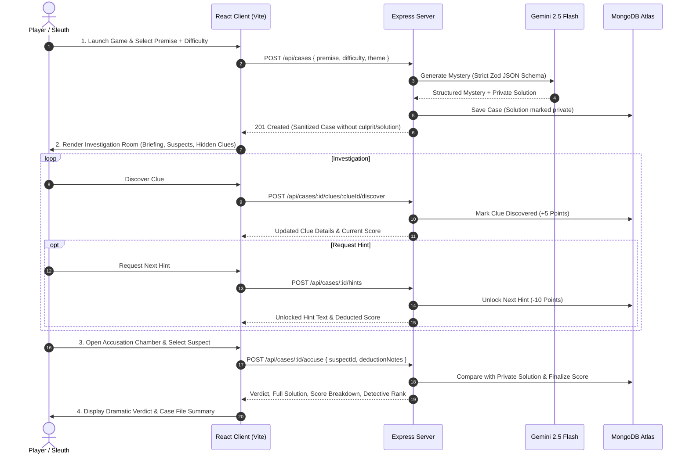

# SPEC.md — AI Mystery Room Specification

## 1. Project Overview & Problem Statement

### 1.1 Overview
**AI Mystery Room** is an interactive, AI-powered detective web application where players enter a premise, select a challenge tier, and step into an immersive mystery generated on-the-fly using Google Gemini. Players examine suspects, discover forensic and testimonial clues, strategically request hints, and submit an accusation against the culprit.

### 1.2 Problem Statement
Traditional murder mystery and escape room games are static and have zero replay value once solved. Procedural or text-based alternatives often suffer from hallucinations, incoherent logic trails, or spoiler leaks where the solution is exposed to the client-side bundle. **AI Mystery Room** solves this by leveraging Gemini structured JSON generation governed by a server-side validation and anti-cheat architecture. The true culprit, motive, and unrevealed hints remain strictly quarantined on the server until the final accusation is submitted.

### 1.3 Target Audience & User Experience
* **Target Users**: Puzzle enthusiasts, casual gamers, mystery fans, and tech evaluators.
* **Expected Experience**: 
  * Atmospheric noir aesthetic with vintage typewriter typography, confidential stamps, and case-file dossiers.
  * Interactive investigation board with audio-visual feedback when uncovering clues.
  * Clear deduction paths backed by consistent alibis, motives, and forensic evidence.
  * High-stakes accusation sequence with instant evaluation and detective rank certification.

---

## 2. Technology Stack

| Layer | Technology | Rationale / Purpose |
| :--- | :--- | :--- |
| **Frontend Framework** | React 19 (Vite) | Lightning-fast build times, reactive state management, modern component architecture |
| **Styling & Icons** | Tailwind CSS + Lucide React | Noir detective visual system, responsive utility styling, lightweight iconography |
| **Animations & Effects** | Canvas-Confetti + Web Audio API | Tactile clue revelation feedback, victory fanfare, typewriter sound effects |
| **Backend Framework** | Node.js + Express.js | Scalable REST API, modular middleware architecture, secure request handling |
| **Database** | MongoDB + Mongoose | Flexible document schema for dynamic mystery content and player state persistence |
| **AI Engine** | Google Gemini API (`@google/genai`) | Model: `gemini-2.5-flash` with structured JSON output schema |
| **Validation & Schemas** | Zod | Strict runtime validation of AI outputs and client API payloads |
| **Security** | Express CORS, Dotenv, Mongoose Projections | Zero-leak solution quarantine, sanitized client DTOs, environment isolation |

---

## 3. Core Features & Top 0.1% Enhancements

### 3.1 Core Features (Mandatory per Spec)
1. **Dynamic Mystery Generation**: AI generates complete cases (title, story, suspects, clues, hints, solution) tailored to the player's chosen premise and difficulty.
2. **Three Difficulty Tiers**: Easy, Medium, and Hard with calibrated suspect, clue, and hint counts.
3. **Interactive Investigation Room**: Case briefing, suspect dossiers with alibis and motives, and clickable clue discovery.
4. **Hint System**: Incremental hints that assist the player at the cost of a score penalty.
5. **Accusation & Scoring**: Backend-evaluated accusation with authoritative score calculation (min score: 0).
6. **Verdict & Case Reveal**: Complete breakdown of the true culprit, guilt explanation, and evidence trail.

### 3.2 Top 0.1% Enhancements (Elevating Submission Standard)
1. **Zero-Leak Data Quarantine**: Mongoose schema uses strict field projection (`select: false`) so the culprit and unrevealed hints are physically excluded from client network responses.
2. **Zero-Failure AI Fallback Engine**: If Gemini API rate limits or quota errors occur during evaluation, the server seamlessly falls back to pre-seeded, high-polish mystery cases.
3. **Atmospheric Case-File UI**: Classified folder layouts, evidence envelopes, polaroid-style suspect cards, and dynamic "CONFIDENTIAL" stamps.
4. **Interactive Audio System**: Immersive detective sound effects (typewriter keystrokes, evidence discovery chimes, stamp slams, victory fanfares) with instant mute toggle.
5. **Detective Ranking Certificate**: Dynamic detective rank assigned based on difficulty, clues found, and hints used (e.g. *Master Sleuth*, *Senior Inspector*, *Rookie Gumshoe*).
6. **Case History Archive**: Local/database log of solved cases allowing players to review past victories and scores.

---

## 4. User Flow & Game Loop



---

## 5. UI and Page Specifications

### 5.1 Home Screen (`/`)
* **Purpose**: Introduce the application, showcase recent solved mysteries, and provide quick launch buttons.
* **Elements**:
  * Hero banner with noir typography and detective badge badge.
  * "Start New Investigation" primary CTA button.
  * Curated mystery presets (*"The Heist on the Orient Express"*, *"Murder in the Silicon Valley Penthouse"*, *"The Victorian Manor Poisoning"*).
  * Audio toggle control (Ambient noir sound effects on/off).

### 5.2 Create Mystery Screen (`/create`)
* **Purpose**: Configure and trigger the generation of a new mystery case.
* **Elements**:
  * Premise input text area (with auto-suggest quick chips).
  * Genre/Theme selector (Classic 1920s Noir, Cyberpunk Neo-Tokyo, Victorian Gothic, High-Tech Sci-Fi).
  * Difficulty level selector:
    * **Easy**: 3 Suspects | 5 Clues | 2 Hints | +100 Base Points
    * **Medium**: 4 Suspects | 7 Clues | 3 Hints | +150 Base Points
    * **Hard**: 5 Suspects | 9 Clues | 3 Hints | +200 Base Points
  * Typewriter-animated loading state with rotating detective investigation tips while AI generates the case.

### 5.3 Investigation Room Screen (`/cases/:id`)
* **Purpose**: Core interactive hub where players analyze evidence and interrogate suspects.
* **Elements**:
  * **Top HUD**: Case Title, Difficulty badge, Real-time Score Counter, Clues Found counter (`X / Total`), "Accuse Suspect" action button.
  * **Case File Briefing**: Atmospheric memo detailing the crime, location, victim, and initial circumstances.
  * **Suspect Gallery**: Grid of polaroid suspect cards detailing Name, Occupation, Alibi, Stated Motive, and Demeanor.
  * **Interactive Clue Board**: Evidence cards initially displayed as sealed evidence envelopes. Clicking reveals the forensic findings and awards +5 points.
  * **Classified Hint Safe**: Locked hint drawer showing penalty warnings (-10 pts per hint) and revealing progressive clues.
  * **Detective Notebook**: In-game notepad allowing players to jot down hypotheses (auto-saved to browser storage).

### 5.4 Accusation Chamber Modal
* **Purpose**: High-stakes final confrontation.
* **Elements**:
  * Suspect selection selector with suspect mugshots and summaries.
  * Deduction reasoning box ("Why do you accuse this suspect?").
  * Warning prompt: *"Submitting will lock the case and reveal the truth."*
  * Final "Issue Arrest Warrant" confirmation button.

### 5.5 Results & Verdict Screen (`/cases/:id/result`)
* **Purpose**: Reveal the final verdict, evaluate performance, and present the full truth.
* **Elements**:
  * High-impact stamp banner: **CASE SOLVED: CULPRIT APPREHENDED** (Green) or **WRONGFUL ACCUSATION: KILLER AT LARGE** (Crimson).
  * True Culprit Profile: Identity, true motive, and the critical piece of evidence that broke the case.
  * Score Breakdown Ledger:
    * Accusation Base Score: `+100` / `+150` / `+200` (or `0` if wrong)
    * Clues Discovered Bonus: `+(5 × Clues Discovered)`
    * Hint Penalties: `-(10 × Hints Used)`
    * **Final Score** (Minimum: `0`)
  * Detective Rank Badge (*Master Sleuth*, *Senior Inspector*, *Junior Detective*, *Rookie Gumshoe*).
  * Action buttons: "Play Another Mystery", "Review Evidence Board", "Share Case Report".

---

## 6. Backend & Database Design

### 6.1 Database Schema (`models/Case.js`)

```javascript
const CaseSchema = new mongoose.Schema({
  title: { type: String, required: true },
  premise: { type: String, required: true },
  theme: { type: String, default: "Classic Noir" },
  difficulty: { type: String, enum: ["Easy", "Medium", "Hard"], required: true },
  storyBriefing: { type: String, required: true },
  victim: {
    name: { type: String, required: true },
    details: { type: String, required: true }
  },
  crimeScene: {
    location: { type: String, required: true },
    time: { type: String, required: true }
  },
  suspects: [{
    id: { type: String, required: true },
    name: { type: String, required: true },
    occupation: { type: String, required: true },
    alibi: { type: String, required: true },
    motive: { type: String, required: true },
    demeanor: { type: String, required: true },
    avatarUrl: { type: String }
  }],
  clues: [{
    id: { type: String, required: true },
    title: { type: String, required: true },
    description: { type: String, required: true },
    discovered: { type: Boolean, default: false },
    discoveredAt: { type: Date }
  }],
  hints: [{
    id: { type: String, required: true },
    text: { type: String, required: true },
    unlocked: { type: Boolean, default: false },
    order: { type: Number, required: true }
  }],
  // SECURITY QUARANTINE: Hidden from GET /api/cases/:id
  solution: {
    culpritId: { type: String, required: true, select: false },
    culpritName: { type: String, required: true, select: false },
    explanation: { type: String, required: true, select: false },
    criticalClueId: { type: String, select: false }
  },
  playerProgress: {
    status: { type: String, enum: ["in-progress", "solved", "failed"], default: "in-progress" },
    currentScore: { type: Number, default: 0 },
    cluesDiscoveredCount: { type: Number, default: 0 },
    hintsUsedCount: { type: Number, default: 0 },
    accusation: {
      suspectId: { type: String },
      suspectName: { type: String },
      isCorrect: { type: Boolean },
      reasoning: { type: String },
      accusedAt: { type: Date }
    },
    detectiveRank: { type: String }
  }
}, { timestamps: true });
```

### 6.2 REST API Endpoints Specification

#### 1. `POST /api/cases`
* **Description**: Generates a new mystery via Gemini AI and saves it to MongoDB.
* **Request Body**:
  ```json
  {
    "premise": "A rare diamond disappears during a black-tie gala at an art museum.",
    "difficulty": "Medium",
    "theme": "Classic Noir"
  }
  ```
* **Response (201 Created)**: Sanitized Case Object (strictly excludes `solution` and hint texts that are not yet unlocked).

#### 2. `GET /api/cases/:id`
* **Description**: Retrieves an active mystery case for the investigation room.
* **Security Rule**: Uses `.select('-solution')` and filters locked hints. Culprit is never leaked.
* **Response (200 OK)**: Case object with discovered clues and player progress.

#### 3. `POST /api/cases/:id/clues/:clueId/discover`
* **Description**: Marks a specific clue as discovered and adds +5 points to the score.
* **Response (200 OK)**:
  ```json
  {
    "success": true,
    "clue": { "id": "clue-1", "title": "Scratched Glass", "description": "Microscopic glass dust found near the window latch.", "discovered": true },
    "currentScore": 5,
    "cluesDiscoveredCount": 1
  }
  ```

#### 4. `POST /api/cases/:id/hints`
* **Description**: Unlocks the next available hint in sequence and applies -10 points penalty.
* **Response (200 OK)**:
  ```json
  {
    "success": true,
    "hint": { "id": "hint-1", "text": "Pay close attention to who had access to the maintenance corridor.", "unlocked": true, "order": 1 },
    "currentScore": 0,
    "hintsUsedCount": 1
  }
  ```

#### 5. `POST /api/cases/:id/accuse`
* **Description**: Submits the final accusation, compares against `solution.culpritId`, computes final score, assigns detective rank, and marks the case completed.
* **Request Body**:
  ```json
  {
    "suspectId": "suspect-2",
    "reasoning": "The glass cutter residue on her gloves contradicts her gallery alibi."
  }
  ```
* **Response (200 OK)**: Full result object including verdict (`isCorrect`), true culprit, explanation, final score ledger, and detective rank.

#### 6. `GET /api/cases/:id/result`
* **Description**: Retrieves the completed case dossier and verdict. Allowed only when `status != "in-progress"`.

---

## 7. AI Behavior, Structured Schema & Scoring Engine

### 7.1 Gemini Structured Output Zod Schema
```typescript
const MysteryGenerationSchema = z.object({
  title: z.string(),
  storyBriefing: z.string(),
  victim: z.object({
    name: z.string(),
    details: z.string()
  }),
  crimeScene: z.object({
    location: z.string(),
    time: z.string()
  }),
  suspects: z.array(z.object({
    id: z.string(),
    name: z.string(),
    occupation: z.string(),
    alibi: z.string(),
    motive: z.string(),
    demeanor: z.string()
  })),
  clues: z.array(z.object({
    id: z.string(),
    title: z.string(),
    description: z.string()
  })),
  hints: z.array(z.object({
    id: z.string(),
    text: z.string(),
    order: z.number()
  })),
  solution: z.object({
    culpritId: z.string(),
    culpritName: z.string(),
    explanation: z.string(),
    criticalClueId: z.string()
  })
});
```

### 7.2 Calibrated Difficulty Parameters
| Difficulty | Suspects | Clues | Hints | Base Accusation Score | Clue Discovery | Hint Penalty |
| :--- | :---: | :---: | :---: | :---: | :---: | :---: |
| **Easy** | 3 | 5 | 2 | 100 points | +5 pts / clue | -10 pts / hint |
| **Medium** | 4 | 7 | 3 | 150 points | +5 pts / clue | -10 pts / hint |
| **Hard** | 5 | 9 | 3 | 200 points | +5 pts / clue | -10 pts / hint |

* **Final Score Formula**:  
  $$\text{Score} = \max\Big(0,\; (\text{Correct} \times \text{BaseScore}) + (5 \times \text{CluesFound}) - (10 \times \text{HintsUsed})\Big)$$
* If the accusation is incorrect, `BaseScore` is 0, but clue discovery points remain credited.

---

## 8. Acceptance Criteria

- [x] **Generation**: Generates cohesive mysteries across Easy, Medium, and Hard difficulty levels.
- [x] **Zero-Leak Security**: Culprit identity and solution explanation are inaccessible in frontend network payloads prior to final accusation.
- [x] **Clue Discovery**: Interactive clue discovery successfully awards +5 points and updates discovery state.
- [x] **Hints**: Unlocking hints applies -10 points penalty per hint and respects sequential unlock order.
- [x] **Score Floor**: Final score never drops below 0 points.
- [x] **Accusation Evaluation**: Accusation compares correctly on the backend, reveals full explanation, and outputs detective rank.
- [x] **Fault Tolerance**: Fallback seed mysteries seamlessly engage if Gemini API hits rate limits or invalid responses.
- [x] **Production Deployment**: Frontend deployed on Vercel, backend deployed on Render/Railway, connected to MongoDB Atlas.

